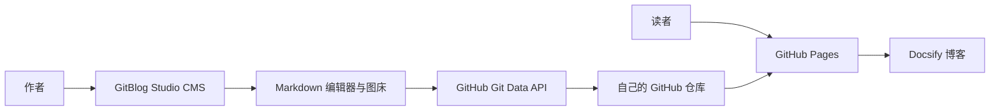

# GitBlog Studio

**基于 GitHub Pages 的一站式个人博客与知识库系统。**

GitBlog Studio 将静态博客、内容管理后台、Markdown 编辑器、GitHub 图床和发布流程整合在同一个 Git 仓库中。你只需要一个 GitHub 账号，就可以搭建自己的博客、在浏览器中写作、上传图片并发布文章。无需额外服务器、数据库、浏览器扩展或第三方 CMS。

## 为什么使用 GitBlog Studio？

- **内容归自己所有**：所有文章都是 Markdown 文件，图片与目录配置也保存在自己的 GitHub 仓库中，可随时备份或迁移。
- **零服务器部署**：博客前台和管理后台都由 GitHub Pages 提供静态托管。
- **浏览器内写作**：内置全屏 Markdown 编辑器，支持实时分栏预览、格式工具栏、粘贴图片与快捷键保存。
- **GitHub 图床**：截图直接粘贴上传，一键复制 GitHub Raw Markdown 链接，不需要额外图床。
- **知识库式导航**：以专题和目录组织文章，自动生成首页卡片、顶部导航、搜索与推荐阅读。
- **开箱即用**：连接自己的仓库后，直接在 CMS 修改博客名称、作者、简介、时区等信息，无需修改 HTML 或 JavaScript。

## 它是如何实现的？



| 部分 | 实现 |
| --- | --- |
| 博客前台 | Docsify 在浏览器渲染 Markdown，动态生成专题卡片和文章阅读页 |
| CMS | 原生 HTML、CSS、JavaScript，内置 EasyMDE 编辑器与 markdown-it 预览 |
| 内容数据 | Markdown 正文、JSON 博客配置、图片资源，全部存放在 GitHub 仓库 |
| 授权 | Fine-grained Personal Access Token，仅授权自己的博客仓库 |
| 发布 | GitHub Git Data API 创建 blob、tree、commit，再非强制更新发布分支；GitHub Pages 自动部署 |

CMS 保存文章时将正文与卡片信息放在同一个 Git 提交中，并自动维护文章创建时间和更新时间。Token 只保存在当前页面内存中，不写入代码和仓库。

## 快速开始

### 1. 创建自己的仓库

1. 打开 [GitBlog Studio 模板仓库](https://github.com/Teletele-Lin/GitBlog-Studio)，点击 **Use this template → Create a new repository**。
2. 选择自己的 GitHub 账号，填写仓库名称，选择 **Public**（GitHub Free 支持公开仓库的 Pages 托管）。
3. 保持 **Include all branches** 不勾选，点击 **Create repository from template**。

仓库可以命名为 `username.github.io`，也可以使用任意项目名称。新仓库拥有独立的 Git 历史，不需要 Fork 原作者的个人博客，也不需要克隆仓库到本地。

### 2. 启用 GitHub Pages

进入自己仓库的 **Settings → Pages**，选择：

| 设置 | 值 |
| --- | --- |
| Source | Deploy from a branch |
| Branch | `main`（若使用其他发布分支，选择实际分支） |
| Folder | `/docs` |

保存后等待 Pages 部署完成。支持用户站点 `https://username.github.io/` 和项目站点 `https://username.github.io/repository/`。

### 3. 连接 CMS

打开博客，点击顶部「内容管理」。CMS 自动识别 GitHub Pages 地址中的 GitHub 用户名和仓库名，默认使用 `main` 分支。如果上一步 Pages 选择了其他发布分支，在 CMS 中填写对应分支即可。

在 [GitHub Fine-grained Token 设置](https://github.com/settings/personal-access-tokens/new)创建 Token：

- Repository access 只选择自己的博客仓库。
- Repository permissions 中的 **Contents** 设为 **Read and write**。
- 保存生成的 Token，并在 CMS 连接页面粘贴登录。

本地预览或自定义域名也可以手动填写仓库信息。

### 4. 个性化和写作

在 CMS 的「博客设置与首页」修改博客名称、站点标识、默认作者、描述、首页简介与时区，然后保存并发布。

接下来创建专题、写文章和上传图片即可。模板仅预存一篇[《开始使用你的博客》](docs/blogs/guide/getting-started.md)，作为更详细的使用指导；开始写作后可以直接在 CMS 中删除它。

## 项目结构

```text
docs/
├── admin/                  # GitBlog Studio 管理后台
├── assets/
│   ├── catalog.json        # 博客设置、目录、文章卡片及时间
│   ├── uploads/            # GitHub 图床
│   └── ...                 # 公共样式和导航
├── blogs/                  # Markdown 正文和专题概览
├── README.md               # 首页内容
└── index.html              # 博客入口
```

## 本地预览

```bash
python3 -m http.server 3000 --directory docs
```

博客：<http://localhost:3000/>；CMS：<http://localhost:3000/admin/index.html>。

## 开发与测试

```bash
node --test tests/catalog.test.cjs tests/admin.test.cjs
```

浏览器测试（使用模拟 GitHub API，不写入真实仓库）：

```bash
npm install --prefix /tmp/blog-cms-test --no-save --no-package-lock playwright-core
NODE_PATH=/tmp/blog-cms-test/node_modules \
CHROMIUM_EXECUTABLE=/path/to/chromium \
node --test tests/admin.browser.cjs
```

## License

GitBlog Studio 模板的原始代码和随附使用指南采用 [MIT License](LICENSE)。第三方库保留各自的许可证及版权声明；使用者自行创作的博客文章与媒体不受模板的 MIT 授权约束，其版权由各自的权利人决定。
